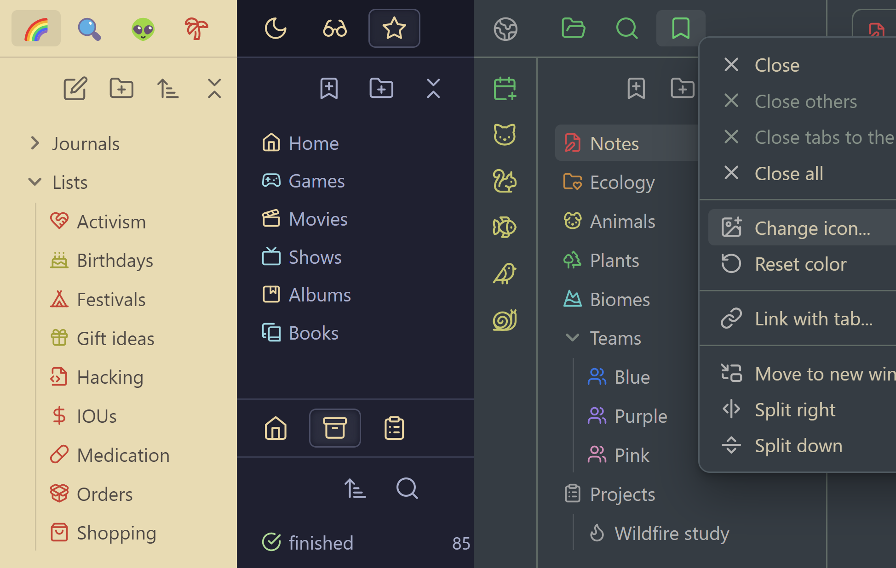
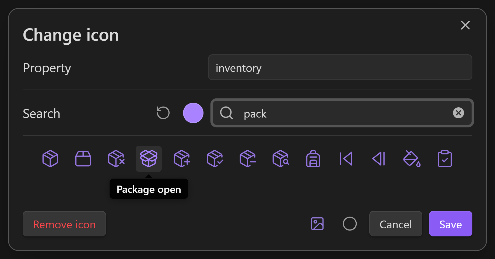
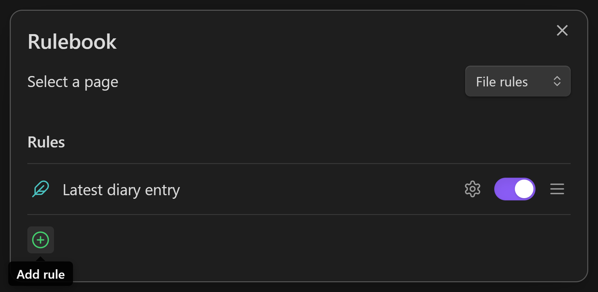
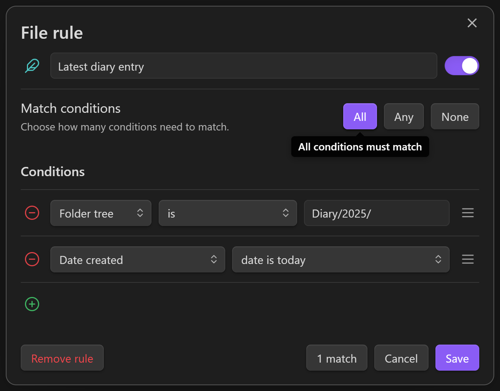

# Iconic

A plugin for iconophiles, designed to blend seamlessly with vanilla Obsidian.

Click almost any icon on a tab, sidebar, ribbon, or the title bar to swap in one of the 1,700+ [Lucide icons](https://lucide.dev/) included in the app, one of the 1,900+ [emojis](https://www.unicode.org/emoji/charts/full-emoji-list.html) that your device supports, or any icons you [import from external libraries](#importing-external-libraries).

> ⤿ Themes: [Ayu Light & Mirage](https://github.com/taronull/ayu-obsidian) / [Fancy-a-Story](https://github.com/ElsaTam/obsidian-fancy-a-story) / [Primary](https://github.com/primary-theme/obsidian)

Includes language support for English, Arabic, German, Spanish, French, Indonesian, Japanese, Russian, Ukrainian, and Simplified Chinese. Most of these languages are currently machine-translated, but if you can supply more accurate translations, please send a message or a pull request :)

## Supported items

- Tabs 📑
- Files & Folders 📝📂
- Bookmarks & Groups 🔖📂
- Tags 🏷️
- Properties 📦
- Ribbon commands 🎀
- Minimize/Maximize/Close buttons 🪟
- Sidebar toggles ◀️▶️
- Help/Settings buttons ❔⚙️
- Pin buttons (on tablets) 📌

## How to use

### Changing an icon

Secondary-click an item from the list above, then click `Change icon` from the menu. You can open menus on mobile by pressing & holding an item. Certain lists like Files, Bookmarks, and Properties let you hold <kbd>Alt</kbd> or <kbd>⇧ Shift</kbd> to select multiple items at once.

Every icon is searchable by name and keywords, which you can view by hovering over (or long-touching) that icon. You can filter between icons and/or emojis by clicking the toggle buttons at the bottom. When you're ready, click an icon to select it immediately.

You can also choose one of nine named colors per icon. These color tones are determined by your current [CSS theme](https://docs.obsidian.md/Reference/CSS+variables/Foundations/Colors#Extended+colors). If you prefer a specific RGB color, secondary-click the bubble to open the full color picker. Click the `Save` button to apply color changes only.

The icon picker will also display a warning if a rule in your rulebook is overruling its icon. To learn about that feature, see the sections below.

### Importing external libraries

In addition to the icons bundled with Obsidian, Iconic can import icons from external icon libraries, such as [Lucide Lab](https://lucide.dev/icons/), which hosts experimental icons that aren't part of the core set, and [Phosphor Icons](https://phosphoricons.com/), a family of icons, imported in its regular weight.

Open the plugin settings, enable **External libraries**, then toggle on the libraries you want to import. External icons are fetched from the internet while their library is enabled, appear in the icon picker alongside the built-in icons, and are searchable by name and keywords like any other icon. If a library is turned off, icons assigned to it revert to the default.

### Setting up rules

You can set up a rulebook to automate your file & folder icons based on a variety of conditions, like their name, their extension, their parent folder, their tags, their property values, the date you've created or modified them, and even the current time of day. Automated icons never remove your custom icons — only replace them visually — so you can be as experimental as you want.

Open the rulebook from the ribbon, from the plugin settings, or by using the `Open rulebook` command. There are currently two pages in the rulebook: `File rules` and `Folder rules`, which affect files and folders respectively.

Click the `+` button to add a new rule, or secondary-click an existing rule to open a submenu with more actions.

Every rule has a name, and an icon, which will overrule the icon of anything that it matches. You can enable and disable a rule using its toggle switch. Rules at the top of the list have the highest priority, and you can drag them up & down using their handles.

To start editing a rule, click the `⚙️` beside it.

### Editing a rule

You can edit a rule's conditions in this window. A condition is a true or false test — it either matches, or it doesn't, and you can add any number of conditions to a rule. Rules interpret their conditions based on their `All` / `Any` / `None` setting. For example, if you want a rule to match when *any* of its conditions match, click the `Any` button. You can always see what your rule is matching by clicking the `Matches` button at the bottom.

If a rule is overruling an icon anywhere in Obsidian, you can secondary-click that icon and choose `Edit rule` to return to this window quickly.

There are several types of conditions you can add to a rule:

- `Icon` checks the icon set to a file/folder
- `Color` checks the color set to a file/folder
- `Name` checks the simple name of a `File`/`Folder`
- `Filename` checks the full name of a `File.md`
- `Extension` checks the file extension, like `md`, `canvas`, `jpg`, etc.
- `Folder path` checks the initial `Path/Leading/To/Your/` file
- `Path` checks the entire `Path/Leading/To/Your/File.md`
- `Headings` checks for `# Headings` inside a note
- `Links` checks for `[[Links]]` inside a note
- `Embeds` checks for `![[Embeds]]` inside a note
- `Tags` checks for tags inside a note, including `#hashtags` and the `tags` property
- `Created time` checks the date & time a file was created
- `Modified time` checks the date & time a file was modified
- `System clock` checks the date & time on your device
- `Properties...` checks the value of a specific property inside a note

Date & time conditions are checked once every minute, so you can use them to modify your icons in real time.

## What makes this plugin different from [Iconize](https://github.com/FlorianWoelki/obsidian-iconize)?

Iconic and Iconize can both change the icons & colors of files & folders, and automate icons based on their filepath. But Iconic can also:

- Change icons by clicking them directly
- Change icons & colors from the same dialog
- Dynamically shift colors to match your theme
- Automate icons using a conditional rule system
- Change icons of plugin tabs, tags, properties, ribbon commands, and window buttons

### Can I use both plugins together?

Sort of, just expect a few visual bugs! They currently do some fighting over control of tab icons and the Bookmarks pane.

## License

This plugin is released under an [MIT No Attribution](https://choosealicense.com/licenses/mit-0/) license, which means you're free to modify and republish its source code without crediting the authors of this repository. It also protects those authors from liability for accidental damages, so I recommend using a similar license if you republish this code.

> [!IMPORTANT]
> This license does **not** cover the [`/res`](https://github.com/gfxholo/iconic/tree/main/res) folder, which contains copyrighted text licensed by Lucide Icons and Unicode, Inc. These licenses require attribution. See [`LICENSES-THIRD-PARTY`](https://github.com/gfxholo/iconic/blob/main/LICENSES-THIRD-PARTY.md) for details.
